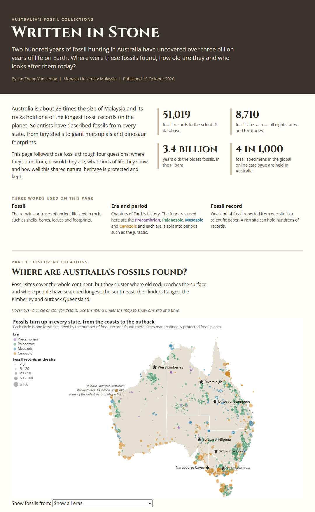

# Written in Stone: Australia's Fossil Collections

### [View the live page](https://imosleo.github.io/australian-fossils/)

A one-page data story built with Vega-Lite that asks three questions about Australia's fossils: where were they found, how old are they and who looks after them today? It follows 51,019 fossil records from 8,710 sites across 200 years of discovery, covering more than three billion years of life on Earth.

| | |
|---|---|
| **Author** | Ian Leong Zheng Yan |
| **Unit** | FIT3179 Data Visualisation, Monash University Malaysia, Data Visualisation 2 |
| **Period** | October 2026 |
| **Stack** | Vega-Lite 5, Vega-Embed, HTML, CSS, Pure.css grid, Google Fonts |

[](https://imosleo.github.io/australian-fossils/)

## What the page covers

The story runs in five parts, each answering one piece of the question.

| Part | Question | Charts |
|---|---|---|
| 1. Discovery locations | Where are the fossils found? | fossil site map with an era filter, choropleth of records per 10,000 km², top ten rock formations |
| 2. Geological periods | How old are they? | streamgraph of life through time, one map per era, box plot of site age by state |
| 3. Fossil types | What kinds of life do they show? | range chart of each group's time window, heatmap of period by group |
| 4. Historical change | When were they discovered? | dot map linked to a discovery timeline (drag to filter), bump chart of state rankings by decade |
| 5. Heritage preservation | Who looks after them? | flow map of where specimens are held, waffle chart of the share held in Australia |

That is 12 charts, including 5 maps. All maps use an Equal Earth projection centred on Australia.

## Data sources

- [Paleobiology Database](https://paleobiodb.org): Australian fossil occurrences and the geological time scale (CC BY 4.0)
- [GBIF](https://www.gbif.org/occurrence/search?country=AU&basis_of_record=FOSSIL_SPECIMEN): fossil specimens collected in Australia and the institutions that hold them
- [National Heritage List Spatial Database](https://data.gov.au/data/dataset/national-heritage-list-spatial-database-nhl-public), Department of Climate Change, Energy, the Environment and Water (CC BY 3.0 AU)
- [ABS state and territory boundaries 2021](https://www.abs.gov.au/statistics/standards/australian-statistical-geography-standard-asgs-edition-3/jul2021-jun2026/access-and-downloads/digital-boundary-files) (CC BY 4.0)
- [Natural Earth](https://www.naturalearthdata.com): world countries and graticules (public domain)

All data was downloaded on 11 October 2026.

## Repository layout

```
index.html   the page
css/         layout.css (grid and spacing) and style.css (fonts and text)
js/          one Vega-Lite spec per chart (.vg.json) and the map files (.topojson)
data/        the cleaned CSV files the charts read
images/      the preview image above
```

To run it locally, serve the folder (for example with VS Code Live Server or `python -m http.server`) rather than opening `index.html` directly, because browsers block the chart files from `file://`.
